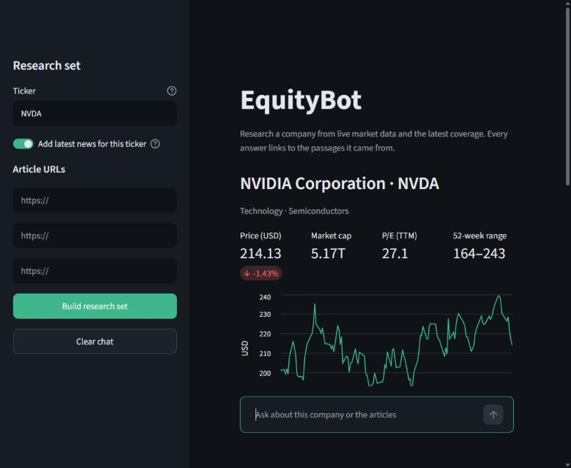

# EquityBot

A research assistant for listed companies. Enter a ticker and EquityBot pulls live market data and the latest news coverage from Yahoo Finance, indexes it alongside any article URLs you add, and answers questions about it in a chat. Every answer links to the passages it was built from.

- **Live app:** https://equity-research-tool-7kkour4wxz3wuccdakcuhi.streamlit.app/
- **Code:** https://github.com/Nitesh1123/equity-research-tool



## What it does

- **Company snapshot.** Price and daily change, market cap, trailing P/E, 52-week range and a six-month price chart for any Yahoo Finance symbol (`NVDA`, `AAPL`, `RELIANCE.NS`, ...).
- **News included automatically.** The most relevant recent articles for the ticker are fetched and indexed with the market data, so you can ask about valuation and news in the same chat.
- **Your own sources.** Add up to three article URLs. Sites that block automated requests are skipped and reported rather than failing the whole run.
- **Chat with follow-ups.** Questions like "what about its margins?" are resolved against the conversation. Compound questions are split into sub-questions and searched separately, so an answer can draw on several articles at once.
- **Checkable answers.** Each reply lists its sources and the exact passages used.

## How it works

1. Market data from `yfinance` is written into a short text document; news and URL articles are loaded with LangChain's `WebBaseLoader`.
2. Everything is split into ~1,000-character chunks and embedded with Google's `gemini-embedding-001` into an in-memory FAISS index. Embedding runs in batches and waits out Gemini free-tier rate limits.
3. For each question, Gemini rewrites it into standalone sub-questions, MMR search retrieves passages for each, and `gemini-2.5-flash` writes a streamed answer using only those passages.

Each browser session has its own index, so users of the hosted app never see each other's research.

## Run it locally

Requires Python 3.10+ and a [Gemini API key](https://aistudio.google.com/apikey).

```bash
git clone https://github.com/Nitesh1123/equity-research-tool.git
```

```bash
cd equity-research-tool
```

```bash
pip install -r requirements.txt
```

Create a `.env` file in the project root:

```
GOOGLE_API_KEY=your_gemini_api_key
```

Then start the app:

```bash
streamlit run main.py
```

## Project structure

- `main.py`: the Streamlit app.
- `.streamlit/config.toml`: theme and toolbar settings.
- `requirements.txt`: Python dependencies.
- `.env`: your `GOOGLE_API_KEY` (not committed).
